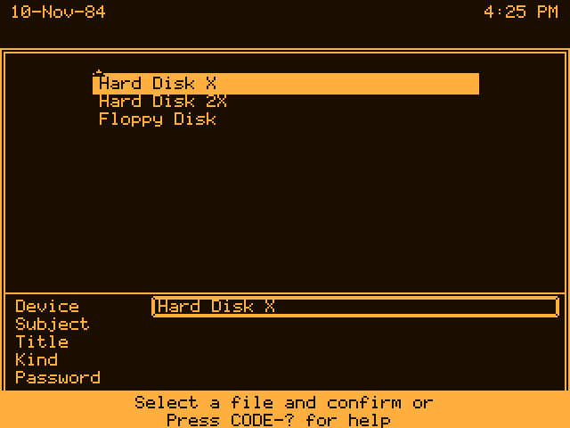
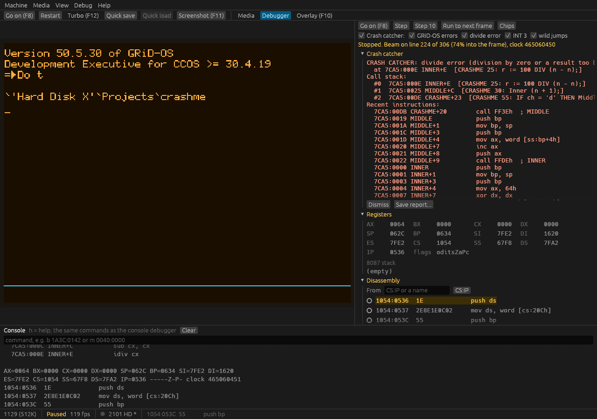

# Compass-Emu

A cycle-accurate emulator of the **GRiD Compass** (1982). Its
timing is fitted to measurements from a real Compass 1101 and 1137. It runs GRiD-OS,
the Executive, the GRiD compilers and the programs written for them. It runs the GRiD
firmware of the keyboard, the disk drives and the modem on their own emulated chips. It
also has a fast core that makes it usable as a build machine.

> **Version 0.13.0, the first beta release.** Expect rough edges.





## Contents

- [What it emulates](#what-it-emulates)
- [How accurate it is](#how-accurate-it-is)
- [Getting started (Windows)](#getting-started-windows)
- [Documentation](#documentation)
- [Building GRiD programs and the Claude Code hook](#building-grid-programs-and-the-claude-code-hook)
- [Building from source](#building-from-source)
- [Left to do](#left-to-do)
- [Reporting problems](#reporting-problems)
- [How this was made (AI disclosure)](#how-this-was-made-ai-disclosure)
- [Sources and credits](#sources-and-credits)
- [License](#license)

## What it emulates

### The machine

| | |
|---|---|
| **Models** | **1101** and **1109** (original board, 320 x 240). **1121** and **1129** (Compass II split board, with the 1101's timers and timing). **1131**, **1137** and **1139** (split board, 512 x 256 screen, discrete 8254 + 8259A, timing fitted to a real 1137). Each model gets its own RAM size (256K or 512K), boot PROM, keyboard firmware and sound wiring. The 1137 has no modem, and its sound chips sit on the motherboard. |
| **CPU** | 8086 with prefetch queue and bus timing (from MartyPC), plus the Compass's own quirks: display RAM contention, DRAM refresh locked to the display frame, and one extra clock on JMP SHORT. A fast whole-instruction core for builds, which can be switched at any instruction. |
| **FPU** | 8087 with bit-exact 80-bit arithmetic in every rounding mode. When you supply the chip's microcode ROM file, it runs **the 8087's own microcode**, and its timing comes from the micro-instructions that ran. Without the file, it uses an instruction-level model. GRiD-OS's trick of turning each 8087 WAIT into INT 3 costs what it costs on the real machine. See [docs/8087-microcode.md](docs/8087-microcode.md). |
| **Display** | Electroluminescent (EL) screen drawn as the beam fetches it, so racing the beam and tearing look as they do on the real screen. Optional EL panel look (glow, pixel gaps, afterglow). |
| **Timers and interrupts** | 80130 on the 110x/112x, 8254 + 8259A on the 113x, each with the quirks measured on real boards. MM58174 real-time clock. |
| **Keyboard** | The 8741 keyboard controller runs GRiD's own firmware (300067-01 or 300001-02), including the 2-key limit and the GPIB watchdog. |
| **Sound** | Sound DAC, volume DAC and DTMF chip, played through the PC's sound card. |

### Storage

| | |
|---|---|
| **2101 Disc System** (hard disk + floppy) | **Low level**: the box's own 8088 runs the real 2101 firmware, with the 8291A GPIB chip, WD2797 floppy controller, a Xebec S1410 at command level with ST-225 timing, and the 4-character front-panel display. **Protocol model**: GRiD's disk protocol with real drive mechanics, used when the firmware file is missing. Two 2101 boxes can be attached. |
| **2102 Portable Floppy** | **Low level**: the box's own 8051 runs the real 2102 firmware, wired from the 2102 schematic. It includes the drive powering down after 10 s idle, as on the real box. Otherwise the protocol model. |
| **Bubble memory** | 7220 controller with 384K of 7110 bubbles. Its rotating-loop timing is fitted to a real 1101. |
| **Application ROMs** | The four ROM sockets, so GRiD software on ROM (for example CCOS from a ROM socket) boots and runs. |
| **PC folder as a drive** | A folder on the PC shows up as a GRiD drive. Files added on the PC appear while the machine runs, and what GRiD writes is saved back. |
| **Disk images** | Raw .img, and ImageDisk .IMD (used through an .img made beside it). Write protect per drive. |

### Communication

| | |
|---|---|
| **RS-232** | 8274 serial controller in async mode, connected to a TCP port, a real COM port, or a second emulator as a null-modem cable. |
| **GRiDLink** | 8274 SDLC mode (the RS-422 GRiDLink network), with frames carried over TCP. Tested with GRiD's own CableTest. There is no GRiD Server yet, see [docs/gridlink.md](docs/gridlink.md). |
| **Internal modem** | The modem board's 8749 runs GRiD's own firmware. A line model makes the dial tone, DTMF and pulse dialing, the ring, and the far modem at 300 and 1200 baud (Bell 212A scrambler). The phone line is TCP, and a phone book maps numbers to addresses. GRiDTerm, PhoneLink and Modem~Device~ work. See [docs/modem.md](docs/modem.md). |

### The emulator window

| | |
|---|---|
| **Setup** | Machine profiles (model, ROMs, GPIB devices, bubble, ROM sockets, serial, modem, sound), Import ROMs (finds every GRiD ROM in a folder or zip by its checksum), and shortcuts that start a machine directly. |
| **Running** | Speed from 10 % to 400 % and turbo, full screen, keys by printed letter on any PC layout (or by US position), an on-screen Compass keyboard, pasting text, copying the screen, and drag and drop of disks and states. |
| **Media** | Floppy swapping while running, a floppy library, a 2101 front panel with drive lights, and a media manager with a GRiD file browser (export from any disk, import into images that are not in use). |
| **States** | Quick save and quick load (disks included), and saved states with a picture of the screen, per profile. |
| **Debugging** | Debugger workspace with code, port, interrupt and memory breakpoints, a profiler, call stack, recent instructions, a GRiD-OS call log and a Chips window. Program symbols from a debug build (procedure names, Pascal source lines, breakpoints by name). A crash catcher. Cycle counter marks and a frame meter overlay for timing your own code. |

## How accurate it is

All numbers are from my own runs of GRiDBench, GRiDProbe, 8087 Bench and Disk Toolkit
(test programs written for this) on a real **1101** with a 2101 and a 2102, and a real
**1137**. The questions each measurement answered are in
[docs/real-hw-tests.md](docs/real-hw-tests.md), and the full tables, with GRiDProbe's
bubble and display numbers, are in [docs/accuracy.md](docs/accuracy.md).

### CPU, 8087 and display

| What | Result |
|---|---|
| 8086 instruction set (SingleStepTests suite, both cores) | No register, flag or memory errors. About 94.5 % of tests have exact clock counts. |
| 8086 timing on the Compass (GRiDBench 2.2 jump, memory and REP rows) | 1.2 % rms on the 1101, 1.4 % on the 113x |
| 8087 timing, microcode core (8087 Bench, 2068 timed tests) | 1.45 % mean error against the real 1101 (about 1.5 clocks). |
| 8087 results, microcode core (8087 Bench, 1588 result lines) | All but 34 lines identical to the real chip (the rest are last-bit differences in transcendentals) |
| 8087 transcendentals dumped from a real 1101 (141 results) | 134 bit for bit, 7 one unit off |
| GRiD-OS's WAIT-to-INT 3 overhead per 8087 instruction | 55.8 clocks (real 1101: 55.7), 57.8 on the 113x (real 1137: 58.7) |
| Display frame (GRiDProbe beam finder) | 1101: 307 clocks x 268 lines, 60.8 Hz. 113x: 316 x 263, 60.2 Hz. |

### Disk drives

2101 page reads in ms (GRiDBench 2.1b on the real 1101 + 2101):

| Pattern | Real | Low level | Protocol model |
|---|---:|---:|---:|
| Same page | 19.0 | 21.1 | 19.4 |
| Sequential | 21.1 | 26.8 | 19.4 |
| 8 pages | 53.5 | 63.8 | 65 |
| Random | 130.3 | 132.8 | 130.0 |
| Steps of 1/16 | 122.5 | 118.4 | 120.6 |

2102 page reads in ms (GRiDBench 2.1b, real 2102):

| Pattern | Real | Low level | Protocol model |
|---|---:|---:|---:|
| Same page | 212 | 200 | 197 |
| Sequential | 133 | 121 | 121 |
| Random | 235 | 243 | |
| First/last | 415 | 403 | 395 |
| Steps of 1/16 | 172 | 196 | 211 |

After 12-30 s idle the low-level 2102 powers its drive down. The next read takes 1.8-1.9 s
(real: 1.9-2.0 s). Bubble memory timing and status bytes follow GRiDProbe's seek patterns on
the real 1101 (replayed in `crates/lib/grid_core/tests/devices.rs`).

## Getting started (Windows)

1. Download the zip from [Releases](https://github.com/ConventionalMemories/Compass-Emu/releases)
   and unpack it anywhere.
2. Get the GRiD ROMs and a GRiD-OS disk image. **Neither is included.**
   - ROMs: the MAME sets `grid1101.zip` (1101/1109), `grid1139.zip` (113x), optionally
     `grid1129.zip` (1121/1129), and `grid_keyboard.zip`, or dumps of your own machine.
   - Optional firmware: the 2102 (`300237-02.bin`) and 2101 (`300205-05.bin`,
     `300205-06.bin`) for the low-level drives, the modem (`16020-007.bin`), and the 8087
     microcode (`8087mc.txt`).
   - A GRiD-OS hard disk image (for the 2101) or boot floppy (for the 2102). The 1101 to 1129
     need the 11xx build of GRiD-OS, and the 1131 to 1139 need the 113x build.
3. Start `compass.exe`. On the setup page, press **Import ROMs...** and pick the folder with
   the ROMs. Then choose a model and the disk images, and press **Power on**.

The PC keys go by the letter printed on them, so AZERTY and QWERTZ type what their keys
say. Alt is CODE, F12 is turbo, F11 saves a screenshot, and **Help > Keyboard map** shows the
rest. Booting to the Executive takes about 2.5 minutes at real speed, so press F12 to skip
through it. Disk changes are written to the image files when you power off or close the
window.

The full guide, including the command line, is in [docs/user-guide.md](docs/user-guide.md).
It ships as README.txt in the zip. Which ROM file is which is in [docs/roms.md](docs/roms.md).

The release is Windows only for now. Linux builds from source (see below), and macOS
is untested.

## Documentation

| | |
|---|---|
| [User guide](docs/user-guide.md) | The window, the command line, every feature (ships as README.txt in the zip) |
| [ROM files](docs/roms.md) | Every ROM and firmware file: name, size, checksum, where it comes from |
| [Disks and media](docs/disks.md) | Which GRiD-OS for which model, image formats, blank media, when changes are saved |
| [Disk drives](docs/drives.md) | The 2101 and 2102 at low level and as a protocol model, the PC folder drive |
| [Hardware model](docs/hardware.md) | How each part of the Compass is modelled, per model |
| [8087 microcode](docs/8087-microcode.md) | The 8087 running its own microcode: what runs, timing, what a real chip answered |
| [Internal modem](docs/modem.md) | The modem's firmware, the TCP phone line, the wiring |
| [GRiDLink](docs/gridlink.md) | The SDLC network over TCP and its wire format |
| [Build mode and MCP](docs/build-and-mcp.md) | Building GRiD programs, headless runs, the Claude Code hook |
| [Accuracy](docs/accuracy.md) | Real-vs-emulator numbers in full |
| [Real-hardware tests](docs/real-hw-tests.md) | What was measured and what is still open |
| [Developer guide](docs/developer.md) | Code tour, building, tests, environment variables |

## Building GRiD programs and the Claude Code hook

- **Project > Project window** builds a GRiD Pascal/ASM-86 program from a folder on your PC
  with the GRiD compilers on a development disk. It runs them on a hidden Compass with the
  fast core while your own machine keeps running, and copies the result into the running
  machine. After the first boot of a disk, a build takes a few seconds. From a command
  prompt: `compass build PROJECTFOLDER --disk DEVDISK.img`.
- **`compass mcp`** is an MCP server for Claude Code. Claude can build programs, boot a
  Compass, type on it, look at the screen, read memory, save the disk and time 8086 code in
  clocks (`grid_build`, `grid_boot`, `grid_type`, `grid_screen`, `grid_run`,
  `grid_read_memory`, `grid_save_disk`, `grid_fragment`, `grid_debug`).
  Add it with `claude mcp add compass -- C:\path\to\compass.exe mcp`.

## Building from source

```
cargo build --release -p compass
cargo test --release -p grid_core -p i8087 -p compass
```

Linux needs `libasound2-dev` and `libudev-dev` to build, and `libxkbcommon-x11-0` and
OpenGL to run the window. The Windows build can be cross-compiled with
`--target x86_64-pc-windows-gnu`.

The code is in `crates/lib/grid_core` (the Compass and its drives), `crates/lib/i8087` (the
8087) and `crates/bin/compass` (the window, the command line and the MCP server).
`crates/lib/marty_core` is the part of MartyPC that is kept. The code tour, the tests and
every environment variable are in [docs/developer.md](docs/developer.md).

## Left to do

**Needs a real machine** (test ideas in [docs/real-hw-tests.md](docs/real-hw-tests.md))

- 8087 Bench 3 on a real 1101, to fit the 8087's constant ROM (1584 tests). It should fix
  most of the transcendental results that are still a unit off.
- Modem: trace the 8749's P1.3/P1.4 pins (firmware commands 7 and 8) and the ring line to
  IR7 on a real modem board. Then make a real call between a Compass and a PC modem at 300
  and 1200 baud.
- RS-232 on real hardware: the bit rate at 9600, the fastest rate without lost characters,
  and DCD/CTS behaviour.
- RS-422/GRiDLink testing. The 8274's receive FIFO depth in SDLC
  mode is assumed.
- 113x unknowns: whether the 8259A takes a non-specific EOI, how the 8254's timer 1 is
  gated, and what each DFE04 bit does.
- Only the 1101 and the 1137 were measured. The 1109, 1121, 1129, 1131 and 1139 use their
  fits.

**Known timing gaps**

- The low-level 2101's sequential and multi-page reads (see the table above), and the
  2102's stepped reads.
- Bubble timing was fitted on the 1101 only. The 1137's bubble looked slower.

**Not emulated yet**

- The modem's busy and ringback tones and its speaker. The 8087's arithmetic on unnormal
  operands.


## Reporting problems

Open an [issue](https://github.com/ConventionalMemories/Compass-Emu/issues) with:

- the model and the profile settings (or the shortcut .bat),
- which GRiD-OS disk and which program,
- what you did, what happened, and what a real Compass does, if you know,
- a saved state or screenshot if you can.


## How this was made (AI disclosure)

Almost all of the Compass-specific code and documentation in this repository was written by
Claude, Anthropic's AI model, working in Claude Code. I directed the work, set its
requirements, and ran every real-hardware test on my GRiD Compass 1101 and 1137. The timing
models were fitted to those measurements. The 8086 core and the emulator framework come
from MartyPC, written by Daniel Balsom.

Expect the strengths and weaknesses that come with that. Behaviour is backed by
measurements and GRiD's own sources where noted, but please report anything that differs
from a real Compass.

## Sources and credits

Special thanks to **vklachkov** and **JDat**. Their MAME work, reverse
engineering and schematics of the GRiD Compass and its drives made this emulator possible to
build and to check.

- **GRiD Systems source code** from original GRiD development disks: the boot PROM
  (Cp: cp.main, Rom.Asm, BankSwitch.PLM, splitboard.gpib.asm), the GRiD-OS system-dependent
  code (SysDep: RomDriver, RomDir, Os.Sysdep) and the file system.
- **GRiD documentation**: *Programming EPROMs for GRiDCase and Compass* (031031-44, 1986),
  *US patent 4,571,456* (GRiD Systems): clocks, display RAM arbitration, GPIB pseudo-DMA
  and its keyboard watchdog, serial clock latches.
- **MAME**: the gridcomp, grid2102 and gridkeyb drivers (Sergey Svishchev, usernameak, Vas
  Crabb and others), and the tms9914, i7220, z80sio and mm58174 devices
  (BSD-3-Clause), for the memory map, keyboard matrix and device behaviour.
- **[vklachkov](https://github.com/vklachkov)**: much of MAME's GRiD Compass emulation,
  tracked in [mamedev/mame#16845](https://github.com/mamedev/mame/issues/16845): the
  low-level keyboard, the 113x screen modes, 2102 geometry and formatting, RS-232, the 8087
  hookup, the test ROM and machine-ID ROM devices, bubble memory, and ROM dumps. Also the
  reverse engineering in [grid-compass-fdd-2102](https://github.com/vklachkov/grid-compass-fdd-2102)
  and [grid-compass-2101](https://github.com/vklachkov/grid-compass-2101), and
  [grid-compass-network](https://github.com/vklachkov/grid-compass-network) (MIT), whose
  reversed MS-DOS modem driver and Setochka GRiD Server were used to check the internal modem.
- **[JDat](https://github.com/JDat)**: schematics of the 2102 floppy drive (the base of the
  low-level 2102), the internal modem board (used to check the modem's pin wiring), and part
  of the 1101 motherboard.
- **MartyPC** by Daniel Balsom: the 8086 core and emulator framework (MIT).
- **Real-hardware measurements** by me: GRiDBench 2.x, GRiDProbe and 8087 Bench runs on a
  1101 (with 2101 hard disk and 2102 floppy) and a 1137, Disk Toolkit seek tests, Rom
  Toolbox dumps of the boot PROMs and application ROMs, the keyboard controllers,
  and the internal modem's 8749 firmware dump.
- **Ken Shirriff's 8087 articles** (righto.com), for the microcode engine, FPTAN's method
  and the constant ROM.
- **The 8087 microcode dump** from the granite project (github.com/a-mcego/granite), whose
  text format the microcode core reads. The ROM itself is not included. You supply the file.
- **Datasheets**: Intel 8086, 8087, 8741/8041 (UPI-41), 8048/8749, 8051, 8088, 8255,
  8259/80130, 8254, 8274, 8291A, 7220 bubble memory controller; TI TMS9914; WD2797; National
  MM58174.
- **SingleStepTests** 8086 test suite, for checking both CPU cores.
- **rustc_apfloat** (Apache-2.0 WITH LLVM-exception) for 8087 arithmetic.

MartyPC's own credits are kept in [CREDITS.md](CREDITS.md).

## License

MIT, see [LICENSE](LICENSE). Compass-Emu by Conventional Memories (C.M._), based on MartyPC
by Daniel Balsom (what was kept is in [MARTYPC.md](MARTYPC.md)). GRiD ROMs and software are
not part of this repository.
