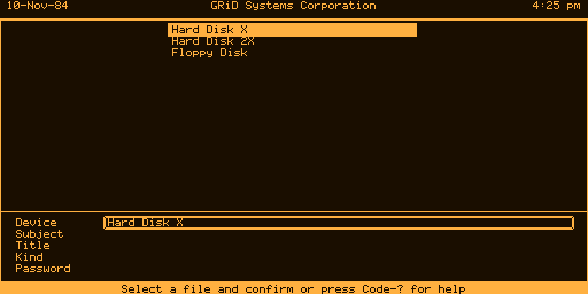
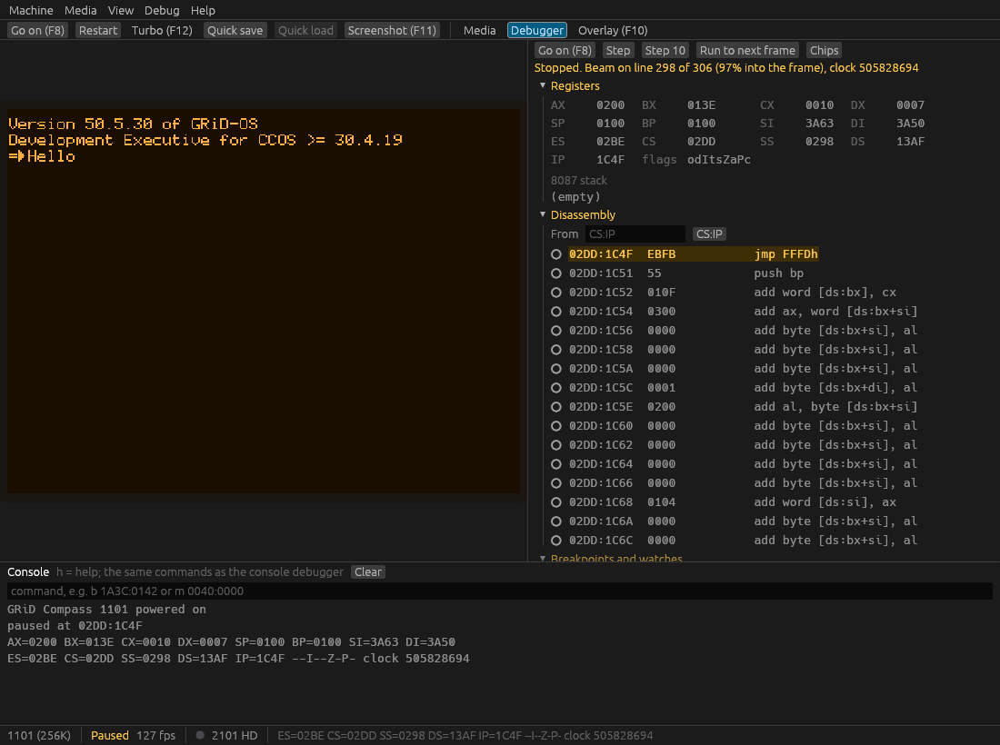

# Compass-Emu

[](https://github.com/ConventionalMemories/Compass-Emu/actions/workflows/compass.yml)

A cycle-accurate emulator of the **GRiD Compass** (1982), the first clamshell laptop, with
its timing checked against real machines. It runs GRiD-OS, the Executive, the GRiD
compilers and the programs written for it, and fast enough to use as a build machine.







## What it emulates

| | |
|---|---|
| Models | 1101, 1109 (original board); 1121, 1129, 1131, 1137, 1139 (Compass II split board, 512 x 256 screen on the 113x), each with its own timer and interrupt chips and sound wiring |
| CPU | 8086 with prefetch queue and bus timing, plus a fast whole-instruction core for builds |
| FPU | 8087 with bit-exact 80-bit results; runs the chip's own microcode when you supply the ROM file (see [docs/8087-microcode.md](docs/8087-microcode.md)), an instruction-level model otherwise |
| Storage | 2101 hard disk and floppy, 2102 portable floppy, bubble memory, application ROM sockets, a PC folder as a GRiD drive |
| I/O | 8741 keyboard controller running GRiD's firmware, 8274 serial (TCP, COM port, or a null-modem link between two emulators), sound DAC, DTMF, real-time clock |
| Window | Menus, machine setup with saved profiles, media manager (floppy swapping, GRiD file browser with import/export), quick save and state files |
| Demo tools | Cycle counter marks (OUT to ports a real Compass ignores), frame meter overlay, debugger workspace with code/port/interrupt/memory breakpoints, profiler, chips window; program symbols from debug builds (names, Pascal source lines, breakpoints by name, call stack) and a crash catcher |
| Display | Electroluminescent (EL) screen with RAM contention and a beam-accurate picture, so racing the beam works as on the real machine |

Accuracy, measured with GRiDBench on a real 1101 with a 2101 and a 2102:

- Plain 8086 code and memory access: within about 2% on average.
- 8087 instruction times: mostly within 5%; on the microcode about 2% on average (8087 Bench, 2068 tests on a real 1101 and 1137).
- 2101 page reads: same page 19.4 ms (real 19.0), sequential 19.4 (21.1), random 130.0 (130.3).
- 2102 page reads: within about 10% for most patterns.

Not emulated yet: the modem (its microcontroller was only just dumped), GRiDLink
(synchronous serial) and the test ROM socket. Known timing gaps are listed in
[COMPASS.md](COMPASS.md).

## Getting started (Windows)

1. Download the zip from [Releases](https://github.com/ConventionalMemories/Compass-Emu/releases).
2. You need the GRiD ROMs and a GRiD-OS disk image. They are not included. The ROMs are
   the MAME sets `grid1101.zip`, `grid1139.zip` (optionally `grid1129.zip`) and
   `grid_keyboard.zip`.
3. Unpack the zip next to your `roms` and `disks` folders and start
   `Start Compass-Emu 1101.bat` or `Start Compass-Emu 1139.bat`.

Keys map by position; Alt is CODE, F12 is turbo, F11 saves a screenshot. The full guide,
command line and build mode are in [docs/user-guide.md](docs/user-guide.md).

## Building from source

```
cargo build --release -p compass
cargo test --release -p grid_core -p i8087 -p compass
```

Linux needs `libasound2-dev` and `libudev-dev` to build, and `libxkbcommon-x11-0` and OpenGL to run the window. The Windows build is cross-compiled with
`--target x86_64-pc-windows-gnu`. Technical notes on the hardware model are in
[COMPASS.md](COMPASS.md); the code is in `crates/lib/grid_core`, `crates/lib/i8087` and
`crates/bin/compass`.

## How this was made (AI disclosure)

Almost all of the Compass-specific code and documentation in this repository was written
by Claude, Anthropic's AI model, working in Claude Code. Conventional Memories (C.M._)
directed the work, set its requirements, and ran every
real-hardware test on GRiD Compass 1101 and 1137 machines; the timing models were fitted
to those measurements. The 8086 core and the emulator framework come from MartyPC, written
by Daniel Balsom. Expect the strengths and weaknesses that come with that: behaviour is
backed by measurements and GRiD's own sources where noted, but please report anything that
differs from a real Compass.

## Sources

- **GRiD Systems source code** from original GRiD development disks: the boot PROM
  (Cp: cp.main, Rom.Asm, BankSwitch.PLM, splitboard.gpib.asm), the GRiD-OS system
  dependent code (SysDep: RomDriver, RomDir, Os.Sysdep) and the file system.
- **GRiD documentation**: *Programming EPROMs for GRiDCase and Compass* (031031-44, 1986),
  *GRiDCase Technical Reference* (1985).
- **US patent 4,571,456** (GRiD Systems): clocks, display RAM arbitration, GPIB
  pseudo-DMA and its keyboard watchdog, serial clock latches.
- **MAME**: the gridcomp, gridkeyb, tms9914, grid2102, i7220, z80sio and mm58174
  drivers (BSD-3-Clause), for the memory map, keyboard matrix and device behaviour.
- **MartyPC** by Daniel Balsom: the 8086 core and emulator framework (MIT).
- **Datasheets**: Intel 8086, 8087, 8741/8041 (UPI-41), 8259/80130, 8274, 7220
  bubble memory controller; TI TMS9914; National MM58174.
- **SingleStepTests** 8086 test suite, for checking both CPU cores.
- **Real-hardware measurements** by C.M._: GRiDBench 2.x runs on a 1101 (with 2101 hard
  disk and 2102 floppy) and a 1137, Disk Toolkit seek tests, Rom Toolbox dumps of the
  boot PROMs and application ROMs, and the 1137 keyboard controller dump.
- **rustc_apfloat** (Apache-2.0 WITH LLVM-exception) for 8087 arithmetic.

## License

MIT, see [LICENSE](LICENSE). Compass-Emu by Conventional Memories (C.M._), based on
MartyPC by Daniel Balsom (original readme in [MARTYPC.md](MARTYPC.md)). GRiD ROMs and
software are not part of this repository.
